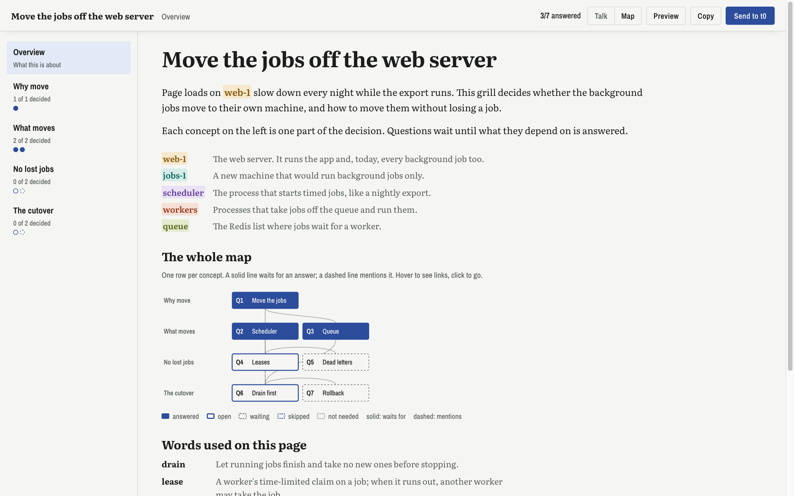
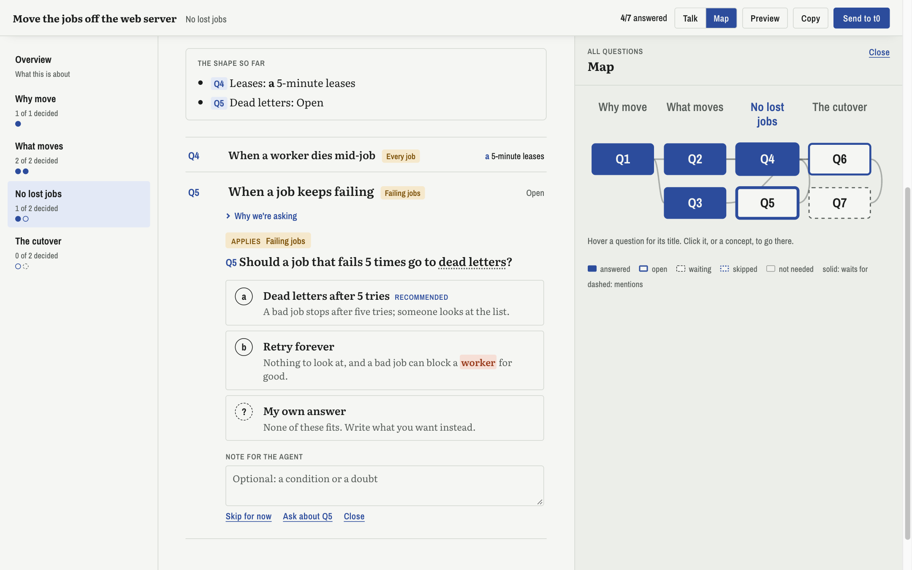
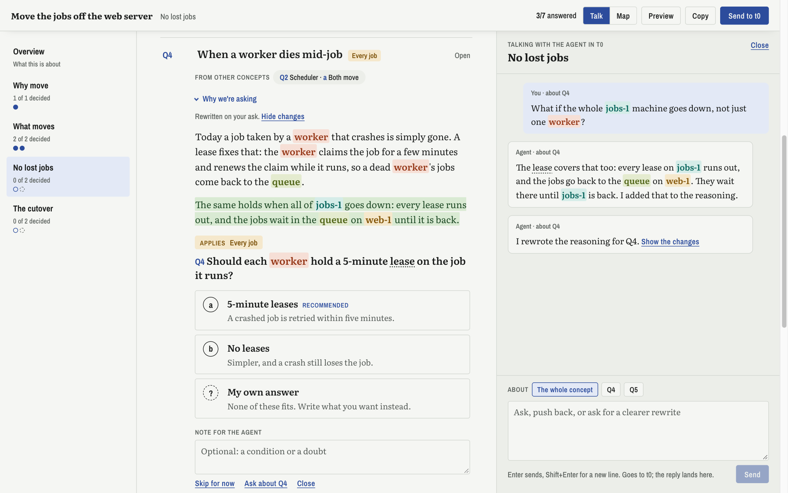
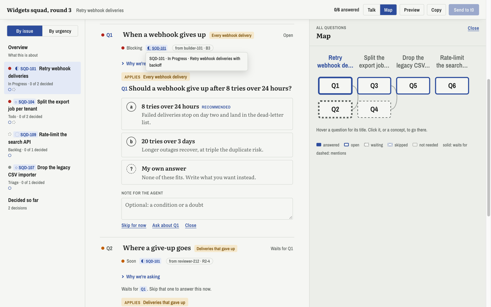
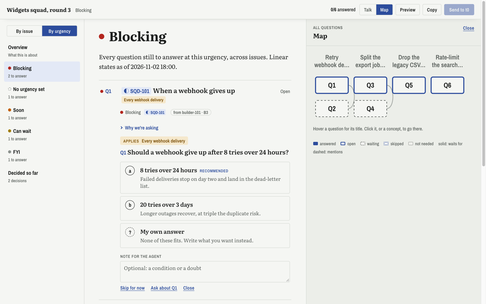

# grill-flow

A local page for an agent's grill: the interview an agent runs to settle a decision with you.
The page lays the reasoning out concept by concept, puts a question at each decision point, says
what each option changes, and greys a question until what it depends on is answered. You answer
on the page, ask about anything you don't follow, and get rewrites back as diffs. Send reviews
your answers, takes an optional message, and types it all into the agent's terminal.



Everything stays on your machine. Every answer, note, ask and rewrite is kept as an event in a
local SQLite file, so you can later mine how you use the pages.

## Two kinds of grill

One page serves both; which one you get depends only on the fields the grill's file fills in.

### A decision grill

The everyday kind: one decision, thought through in order. Start here.

- **Concepts** down the left, one idea each; the page shows one at a time with its part of the
  map.
- **Names in colour.** The agent lists the names that keep coming up (machines, services,
  people) as `entities`, each with a colour. They're coloured the same way everywhere on the
  page, and a key under the introduction says what each one is.
- **A glossary.** Words the reasoning leans on (`terms`) are underlined and explained on hover.
- **Questions that wait.** `dependsOn` greys a question until its inputs are answered; `when`
  marks it not needed after an answer that rules it out. An answered question folds to a line
  with your pick, and the next one opens.



- **Talk per concept.** Ask about a question or the whole concept from the sidebar. The agent
  answers there, or rewrites the reasoning and you see the diff.



`examples/decision-sample.json` is a whole one.

### Questions about issues

Any grill can tie its questions to Linear issues or PRs. The concepts stay the default view, and
the sidebar adds a second one that lists the same questions by issue. Each issue or PR named in
the text links to it and shows its state on hover.

### A squad grill

For a long-running multi-agent effort, where questions from several agents and issues pile up
for one person. It adds, on top of the above:

- **Urgency** on each question (blocking, soon, can wait, FYI), and a third sidebar view that
  lists by urgency. Only a squad grill has it.
- **Who asked**, with the asker's own row id, and **decided so far** from earlier rounds.





`examples/squad-sample.json` uses every field.

## What you need

- macOS or Linux.
- [Bun](https://bun.sh) 1.3 or later. It runs the server, the build and the tests.
- [Claude Code](https://claude.com/claude-code), for the `grill` skill the agent follows.
- Optional: Herdr's `hc`. With the agent in a Herdr terminal, your asks and answers are typed
  straight into it. Anywhere else, Claude desktop included, the agent runs `gf wait` in the
  background and collects them from the page's store instead.

## Get started

```bash
git clone <your fork> grill-flow && cd grill-flow
bun install
bun run gf up          # builds the page and starts the server at http://127.0.0.1:4317
bun run gf load examples/decision-sample.json
```

Open `http://127.0.0.1:4317/g/decision-sample` to see a made-up grill, or `http://127.0.0.1:4317/`
for every grill the server holds, grouped by the machine it came from; a grill page's title links
back there. An agent on another machine can keep its grills there and still have them served here:
it sets `GF_OUTBOX` and this server pulls that folder over hc (`gf remote add <machine> <outbox>`;
docs/adr/0002). `GF_PORT` and `GF_DB`
move the server and its database elsewhere, say for a second copy.

Install the skill from your checkout, so your edits take effect without a release:

```bash
claude plugin marketplace add "$PWD"
claude plugin install grill-flow@grill-flow
```

Then ask an agent for a grill on grill-flow. It writes the grill to `grills/<id>.json`, loads
it and gives you the link.

To make it the default whenever you ask to be grilled, add this line to `~/.claude/CLAUDE.md`
(or to one repo's `CLAUDE.md` for just that repo):

```markdown
- When I ask to be grilled, or a skill runs a grill, put each round on a grill-flow page with the `grill-flow:grill` skill.
```

`bun run dev` serves the page and rebuilds it on every change to `src/`; an open page reloads
itself within a few seconds and keeps what you were typing. `bun test` runs the tests.

## Make it yours

This is a base to fork and bend to how you think, not a product taking requests.

- **The skill**: `plugin/skills/grill/SKILL.md`. Change the checkout path near the top to where
  you cloned it, and the rest to how you want agents to grill you.
- **The look**: `src/styles.css`, with colour tokens for light and dark at the top, including the
  five entity colours. `DESIGN.md` and `PRODUCT.md` record why it looks the way it does.
- **The grill shape**: `src/domain.ts`. A new field goes in the schema, then into `src/view.ts`.
- **Where answers go**: `server/main.ts` sends through `hc send`; swap that for whatever reaches
  your agent.

The page is built with [Foldkit](https://foldkit.dev) on [Effect](https://effect.website); read
`FOLDKIT.md` before changing `src/`. The design work used
[Impeccable](https://github.com/pbakaus/impeccable), installed project-locally into `.claude/`
and not committed.
