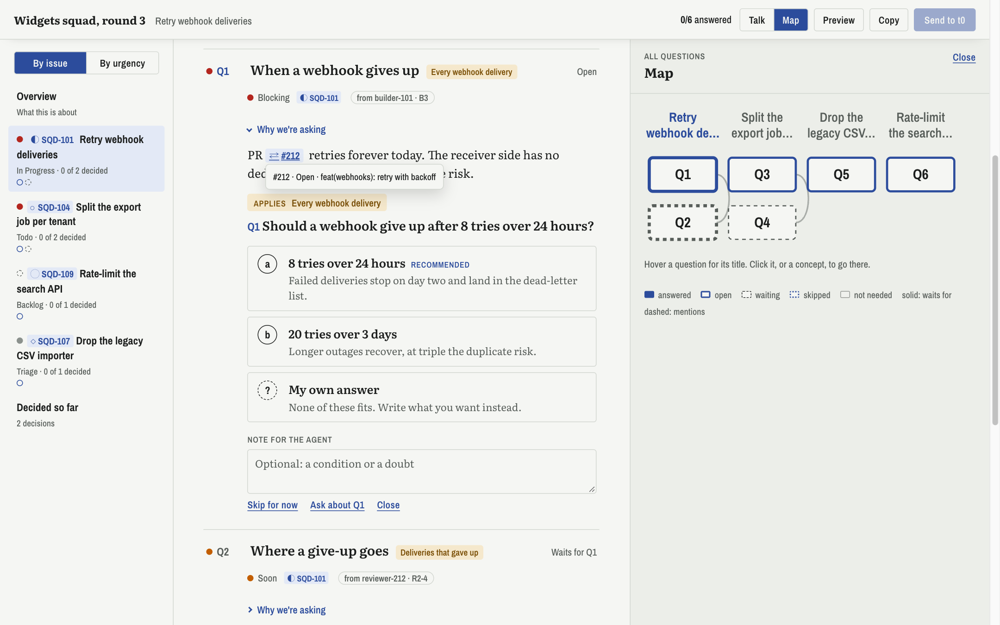
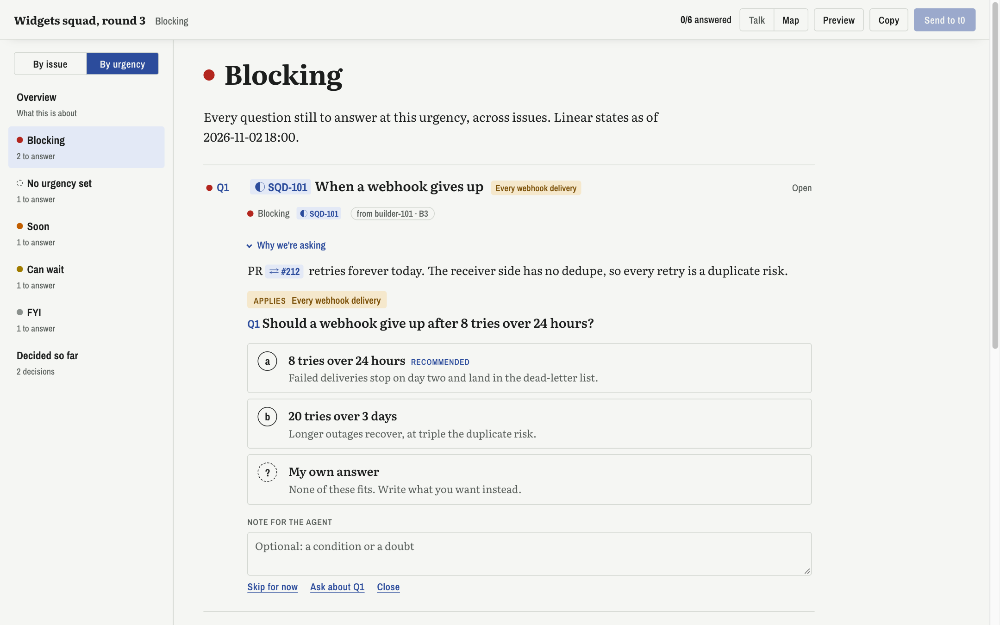

# grill-flow

A local page for an agent's grill: the interview an agent runs to settle a decision with you.
The page lays the reasoning out concept by concept, puts a question at each decision point, says
what each option changes, and greys a question until what it depends on is answered. You answer
on the page, ask about anything you don't follow, and get rewrites back as diffs. Send types your
answers into the agent's terminal.



Everything stays on your machine. Every answer, note, ask and rewrite is kept as an event in a
local SQLite file, so you can later mine how you use the pages.

## What you need

- macOS or Linux.
- [Bun](https://bun.sh) 1.3 or later. It runs the server, the build and the tests.
- [Claude Code](https://claude.com/claude-code), for the `grill` skill the agent follows.
- Herdr's `hc`, which carries your asks and answers into the agent's terminal. The agent runs in
  a Herdr terminal so it has an address (`$HC_TERMINAL_ID`). Without it, Copy still puts your
  reply on the clipboard to paste.

## Get started

```bash
git clone <your fork> grill-flow && cd grill-flow
bun install
bun run gf up          # builds the page and starts the server at http://127.0.0.1:4317
bun run gf load examples/squad-sample.json
```

Open `http://127.0.0.1:4317/g/squad-sample` to see a made-up grill.

Install the skill from your checkout, so your edits take effect without a release:

```bash
claude plugin marketplace add "$PWD"
claude plugin install grill-flow@grill-flow
```

Then, in a Claude Code session running in a Herdr terminal, ask for a grill on grill-flow. The
agent writes the grill to `grills/<id>.json`, loads it and gives you the link.

`bun run dev` serves the page and rebuilds it on every change to `src/`; an open page reloads
itself within a few seconds and keeps what you were typing. `bun test` runs the tests.

## How a grill is shaped

A grill is one JSON file; `Grill` in `src/domain.ts` is the schema and
`examples/squad-sample.json` uses every field.

- **Concepts** (`parts`): one idea each. The sidebar lists them, and the page shows one at a time.
- **Steps**: the reasoning in thinking order, each ending in one question with options, a
  recommendation, and what each option changes.
- **Links between questions**: `dependsOn` greys a question until its inputs are answered; `when`
  marks it not needed after an answer that rules it out. The map draws both.
- **Glossary and names** (`terms`, `entities`): explained on hover wherever they appear.
- **Squad fields**, all optional: urgency, the Linear issue or PR behind a question, who asked,
  and decisions already made. The sidebar then lists by issue or by urgency.



## Make it yours

This is a base to fork and bend to how you think, not a product taking requests.

- **The skill**: `plugin/skills/grill/SKILL.md`. Change the checkout path near the top to where
  you cloned it, and the rest to how you want agents to grill you.
- **The look**: `src/styles.css`, with colour tokens for light and dark at the top. `DESIGN.md`
  and `PRODUCT.md` record why it looks the way it does.
- **The grill shape**: `src/domain.ts`. A new field goes in the schema, then into `src/view.ts`.
- **Where answers go**: `server/main.ts` sends through `hc send`; swap that for whatever reaches
  your agent.

The page is built with [Foldkit](https://foldkit.dev) on [Effect](https://effect.website); read
`FOLDKIT.md` before changing `src/`. The design work used
[Impeccable](https://github.com/pbakaus/impeccable), installed project-locally into `.claude/`
and not committed.
